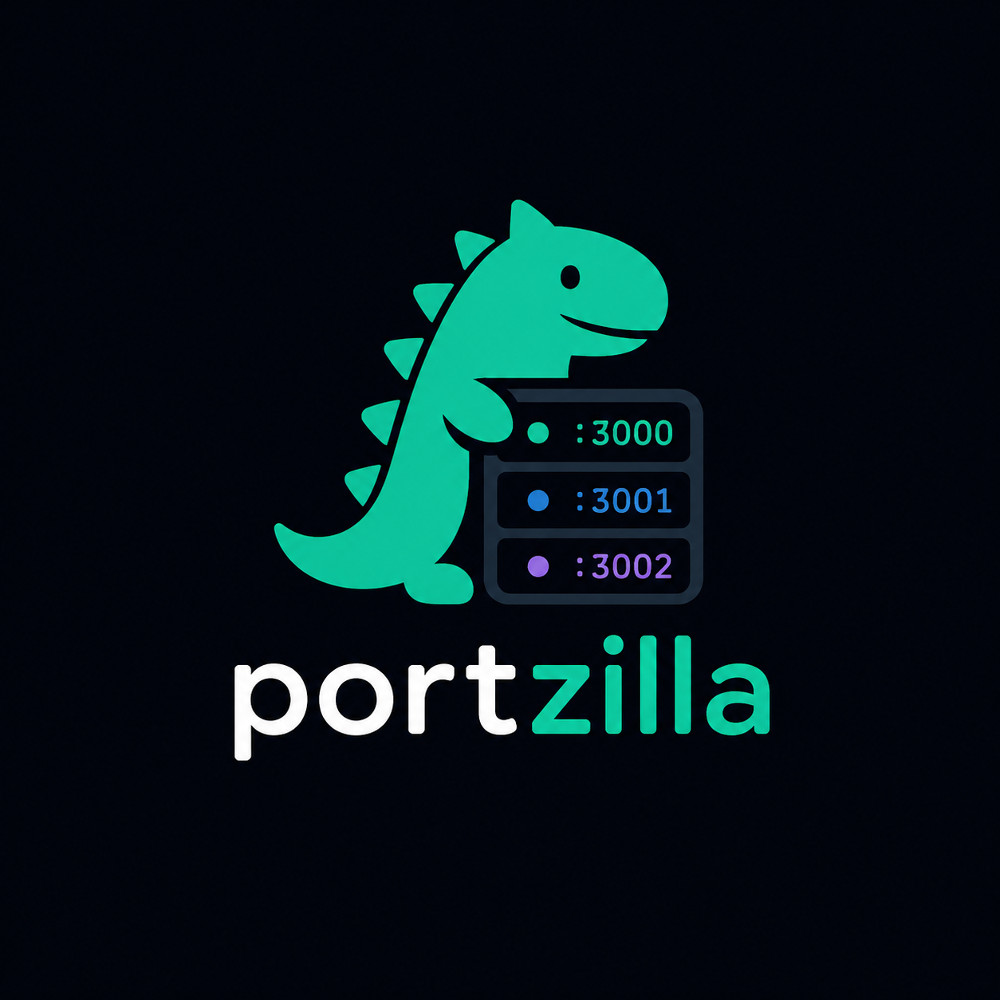
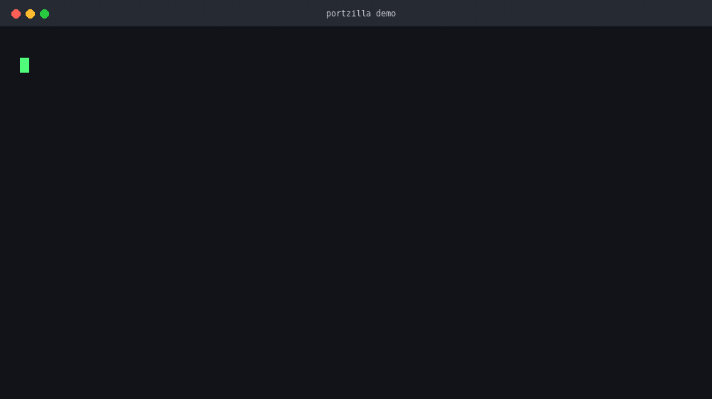

<p align="center">
  
</p>

<h1 align="center">portzilla</h1>

<p align="center">
  <strong>Coordination layer for parallel AI agent sessions — ports, files, and worktree environments.</strong>
</p>

<p align="center">
  <a href="https://github.com/011010/portzilla/actions/workflows/ci.yml"></a>
  <a href="https://crates.io/crates/portzilla"></a>
  <a href="https://www.npmjs.com/package/portzilla"></a>
  <a href="LICENSE"></a>
  [](https://m8ven.ai/mcp/011010-portzilla-qdocjc?s=readme)
</p>

> AI coding agents (Claude Code, Cursor, etc.) run parallel sessions in git worktrees — each starting its own dev server, editing the same files, and pointing at the same database. Today they coordinate by killing whatever is on a port. `portzilla` is the layer that **prevents the conflict**.

| What collides | What portzilla gives you | Start here |
|---|---|---|
| A port both sessions want | A lease with owner PID and purpose tag. Conflicts get the next free port instead of a kill | `portzilla claim 3000 --tag next-dev` |
| A port another agent wants to kill | A guard that intercepts `kill`, `lsof \| xargs kill`, `fuser -k`, `kill-port` and blocks kills against another session's live lease | `portzilla init <harness>` |
| A file both sessions edit | A file intent. A proven conflict is denied; a clean merge is allowed with a warning; hooks do it automatically on OpenCode and Claude Code | `portzilla intent claim src/auth.ts` |
| A database and a `target/` directory both sessions share | An environment slot: its own ports, cache directories, `.env.portzilla`, and a database provisioned by your own commands | `portzilla slot up auth` |

Every layer speaks JSON and is exposed over MCP, so an agent calls it as a tool instead of parsing text. Everything is a single daemon-less binary.

Port allocators and proxies such as [Portless](https://portless.sh) solve addressability and automatic port selection. `portzilla` focuses on a different boundary: declaring which agent session owns a process and preventing another agent from killing it. It stays daemon-less by default, requires no local proxy or CA, and works with any server command that consumes the assigned port.



## Contents

- [Quick start](#quick-start)
- [Demo](#demo)
- [Install](#install)
- [Commands](#commands)
- [Agent skill](#agent-skill)
- [Watch mode](#watch-mode)
- [MCP server](#mcp-server)
- [Audit history](#audit-history)
- [Kill guard](#kill-guard)
- [File intents](#file-intents)
- [Environment slots](#environment-slots)
- [Data file & config](#data-file--config)
- [Limitations](#limitations)

## Quick start

```console
$ portzilla claim 3000 --tag next-dev --session "$CLAUDE_CODE_SESSION_ID"
claimed port 3000 for pid 57107 (tag: next-dev)

$ portzilla who 3000
port: 3000
pid: 57107
tag: next-dev
status: alive

$ portzilla ls
PORT    PID      STATUS AGE        TAG
3000    57107    alive  5s         next-dev
```

Data-producing commands accept `--json` for agent consumption. See [CLI reference](docs/CLI.md).

Prefer `run` when starting a server — it claims the port and holds the lease for the real server process:

```console
$ portzilla run 3000 --tag "vite dev" -- sh -c 'npm run dev -- --port "$PORTZILLA_PORT"'
running on port 3000
```

The exact child command is framework-specific: whatever starts your server must read the assigned port from `$PORTZILLA_PORT`. On conflict `run` reassigns to the next free port and reports it on stderr; the server child's stdout stays untouched.

## Demo

```console
$ portzilla claim 3000 --tag next-dev --pid 57107
claimed port 3000 for pid 57107 (tag: next-dev)

$ portzilla claim 3000 --tag vite-dev --pid 57108
port 3000 is busy (lease conflict); claimed port 3001 instead for pid 57108 (tag: vite-dev)

$ portzilla who 3001 --json
{"port":3001,"pid":57108,"tag":"vite-dev","created_at":1785959877,"session":null,"process_start_time":1785959876,"age_secs":3,"alive":true}

$ portzilla release 3001
warning: released port 3001 whose owning pid 57108 is still alive
port: 3001
pid: 57108
tag: vite-dev
status: alive

$ portzilla prune
no dead leases to prune
```

> Output is real — captured with `PORTZILLA_DATA_DIR` pointed at a temp directory with two live processes.

## Install

**Cargo:**
```console
$ cargo install portzilla
# from local checkout:
$ cargo install --path .
```

**curl** (prebuilt binary to `~/.local/bin`, falls back to cargo):
```console
$ curl --proto '=https' --tlsv1.2 -LsSf https://raw.githubusercontent.com/011010/portzilla/main/scripts/install.sh | sh
# specific version / directory:
$ curl --proto '=https' --tlsv1.2 -LsSf https://raw.githubusercontent.com/011010/portzilla/main/scripts/install.sh | PORTZILLA_VERSION=0.6.0 PORTZILLA_INSTALL_DIR=/usr/local/bin sh
```

**npm** (same native binary):
```console
$ npm install -g portzilla
```

Binaries for Linux x86_64/ARM64, macOS Intel/Apple Silicon, Windows x86_64/ARM64 — each with `.sha256` checksums.

## Commands

| Command | What it does |
|---------|--------------|
| `portzilla claim <PORT> --tag <TAG> [--pid <PID>] [--session <S>]` | Claim a port; on conflict with a live lease from another PID, auto-claims next free port |
| `portzilla ls` | List all leases (`PORT PID STATUS AGE TAG`) |
| `portzilla who <PORT>` | Show lease on a port (exit `2` if none) |
| `portzilla release <PORT>` | Remove lease (always wins; warns if PID still alive) |
| `portzilla prune` | Remove all leases whose PID is dead |
| `portzilla run <PORT> --tag <TAG> [--session <S>] -- <cmd...>` | Claim a port and run a server with it; the lease follows the child PID |
| `portzilla watch [--interval <SECONDS>]` | Repeatedly prune leases whose recorded PID is dead |
| `portzilla guard -- <cmd...>` | Run a command with the kill guard applied, for harnesses without hooks |
| `portzilla init <harness>` | Print the hook/plugin snippet to install; prose on stderr, snippet on stdout |
| `portzilla serve --mcp` | Run the MCP server on stdio |
| `portzilla intent claim\|who\|ls\|release\|history` | File intents: claim a path, inspect the holder, release early, read the journal |
| `portzilla slot up\|env\|run\|ls\|show\|down\|prune` | Environment slots: ports, cache dirs, `.env.portzilla`, database |
| `portzilla history [--json]` | Bounded lease and guard event journal |

Data-producing commands are file-locked and support `--json`. Full flags, conflict semantics, exit codes and JSON shapes → **[docs/CLI.md](docs/CLI.md)**. Slots have their own reference: **[docs/SLOTS.md](docs/SLOTS.md)**.

## Agent skill

For OpenCode agents, install the checked-in `portzilla` skill explicitly:

```console
$ mkdir -p .opencode/skills/portzilla
$ portzilla init skill > .opencode/skills/portzilla/SKILL.md
```

`init skill` only prints the skill file to stdout — it never writes configuration for you; the redirect above is what saves it. The skill teaches the agent to start servers with `portzilla run` and `$PORTZILLA_PORT`. Kill-guard setup stays separate: `portzilla init opencode` prints the `portzilla.js` plugin shim (see [Kill guard](#kill-guard)).

## Watch mode

`portzilla watch` is an optional foreground watcher. It is not a central IPC
daemon: it uses the same locked local state file as the other commands, does
not listen for clients, and agents continue to use the CLI or MCP server for
claims and queries.

```console
$ portzilla watch --interval 30
no leases pruned
pruned port 3000 (pid 57107, tag: next-dev)
```

The watcher validates that `--interval` is a positive number of seconds and
defaults to `60`. It runs one prune cycle immediately, waits for the interval,
then repeats until Ctrl-C. Each cycle checks recorded process liveness, not
lease age, and removes only leases whose recorded server process is no longer
alive. For a new lease, preservation requires a verified process identity: the
current process must match both the recorded PID and `process_start_time`. If
identity could not be resolved when the lease was created, it is intentionally
unverified/dead and may be pruned even when that numeric PID currently exists.
Legacy leases without identity metadata retain PID-only liveness behavior. If
an agent exits while a new lease's verified recorded server process remains
alive, that lease is preserved.

Ordinary store errors are printed to stderr and retried on the next cycle. A
startup error, such as an inability to open the data directory, is fatal and
exits the command instead of entering the retry loop. Ctrl-C shuts down the
watcher successfully.

With `--json`, stdout contains one event per completed cycle, including empty
cycles:

```json
{"event":"watch_cycle","pruned":[]}
{"event":"watch_cycle","pruned":[{"port":3000,"pid":57107,"tag":"next-dev","created_at":1785959877,"session":null,"process_start_time":1785959876,"age_secs":3,"alive":false}]}
```

Diagnostics, including retry and shutdown messages, go to stderr. See the
[CLI reference](docs/CLI.md) for the complete event shape.

## MCP server

For agents with MCP access (Claude Code, etc.) — typed JSON in/out instead of shelling out:

```console
$ claude mcp add portzilla -- portzilla serve --mcp
```

Exposes `claim`, `who`, `ls`, `release`, `prune`, read-only `history`, and the four file-intent tools `intent_claim`, `intent_who`, `intent_ls`, `intent_release`, plus read-only `intent_history`, with the same JSON shapes as `--json`. See **[docs/CLI.md#mcp-server](docs/CLI.md#mcp-server)**.

The intent tools are the only file protection available on harnesses without an edit hook (Cursor, Gemini CLI, Codex, Windsurf): the agent calls `intent_claim` before editing and `intent_release` when it is done. They are cooperative, so they complement rather than replace the OpenCode and Claude Code hooks. **Pass a session string identical to the one your harness gives the hooks**, otherwise your own claims look foreign to the guard.

## Audit history

Portzilla keeps the latest 10,000 operational events alongside the lease state. Lease changes, managed-process exits, and guard denies/warnings are recorded; guard allows and raw shell commands are not.

```console
$ portzilla history --json
$ portzilla history --session my-session --event guard_denied
$ portzilla history clear
```

History is newest-first and supports `--session`, `--port`, `--event`, `--before`, and `--limit`. Hook and guard event writes are best-effort: a journal failure never changes an allow/deny decision. The MCP server exposes the same read-only history query; clearing history is CLI-only. See **[docs/CLI.md#history](docs/CLI.md#history)**.

File intents keep their own journal of the same size in `intents.json`, recording `claim_created`, `claim_refreshed`, `claim_taken_over` and `released` events next to the claims they describe. Query it with `portzilla intent history --session … --event … --limit …`, or read-only over MCP with `intent_history`. Expired records reaped by a new claim are housekeeping and are not logged.

## Kill guard

Makes *checking ownership the default* — blocks `kill` commands that would kill another session's live leased process.

Recognizes `kill <pid>`, `pkill`/`killall`, `lsof -ti:<port> | xargs kill`, `fuser -k <port>/tcp`, `kill-port <port>` (including `sudo`, `env` wrappers and `sh -c` payloads). Verdict: **Allow** / **Deny** (live foreign lease) / **Warn** (unresolvable).

| Harness | Hook | Deny reaches model? | Own-lease? |
|---------|------|---------------------|------------|
| **Claude Code** | `PreToolUse` + `PostToolUse` — `portzilla hook claude-code` | Yes (`permissionDecisionReason`; clean-merge context via `PostToolUse`) | **Yes** (`$CLAUDE_CODE_SESSION_ID`) |
| **Cursor** | `beforeShellExecution` — `portzilla hook cursor` | Likely (`agent_message`) | No |
| **Gemini CLI** | `BeforeTool` — `portzilla hook gemini` | Yes (Deny), no Warn channel | No |
| **Codex CLI** | `PreToolUse` — `portzilla hook codex` | Yes (Deny + Warn via `additionalContext`) | No |
| **Kimi CLI** | `PreToolUse` — `portzilla hook kimi` | Yes (stderr on exit 2) | No |
| **OpenCode** | Plugin shim, V2 API — `portzilla init opencode` | Yes (Deny) | No (V2 gives no session id to shell commands) |
| **Windsurf** | `pre_run_command` — `portzilla hook windsurf` | Yes (stderr) | No |
| **Anything else** | `portzilla guard -- <cmd>` | N/A (exit 2) | **Yes** (`--session` / `$PORTZILLA_SESSION`) |

Setup: `portzilla init <harness>` prints the snippet to add — never writes files for you. The snippet goes to stdout and the instructions to stderr, so a redirect such as `portzilla init opencode > .opencode/plugin/portzilla.js` saves exactly the file. Guard fails open by default; `PORTZILLA_FAIL_CLOSED=1` opts into fail-closed.

Full harness setup, `sh -c` unwrapping rules, and fail-open/closed semantics → **[docs/GUARD.md](docs/GUARD.md)**.

### File intents

Agents in parallel worktrees also collide on *files*: two sessions editing `src/auth.rs` produce a merge conflict that only surfaces at review time. File intents are the same lease idea applied to a path.

Three delivery paths, same store and same verdicts:

| Harness | How the check happens |
|---|---|
| OpenCode | Plugin shim asks on every `write`/`edit` and sends the pending edit |
| Claude Code | `PreToolUse` on `Write`/`Edit`; `PostToolUse` delivers the clean-merge warning |
| Everything with MCP | `intent_claim` / `intent_who` / `intent_ls` / `intent_release` — cooperative, the agent decides to call them |

What the guard does with the pending edit:

- The first session to edit a file claims it for 30 minutes (`PORTZILLA_INTENT_TTL_SECS` overrides the window).
- A session that edits it again refreshes its own claim.
- A *different* live session triggers a conflict check against the holder's working copy. A real conflict is denied, and the reason says the edit conflicts. An edit that merges cleanly is allowed, the holder keeps its claim, and the model reads a warning on the tool result that names the holder.
- Anything the check cannot prove — a v1 record with no recorded location, a git failure, an incomplete edit payload — is denied exactly as before. The check is fail-safe: the softer verdict applies only when cleanliness has been proven.
- A denied attempt claims nothing, so a blocked session cannot take the file by retrying.

The key is `<git-common-dir>:<repo-relative-path>`. The same relative file in two worktrees of one repository is one key; the same absolute path in a different repository is not. Outside a repository the key is the canonical absolute path.

Humans can inspect and clear claims without waiting for the TTL:

```console
$ portzilla intent claim src/auth.rs --session "$CLAUDE_CODE_SESSION_ID"
claimed /repo/src/auth.rs for session ... (expires in 1800s)

$ portzilla intent who src/auth.rs
/repo/src/auth.rs is held by session ... (age 12s, expires in 1788s)

$ portzilla intent ls
KEY SESSION AGE EXPIRES
...

$ portzilla intent release src/auth.rs --session "$CLAUDE_CODE_SESSION_ID"
released /repo/src/auth.rs for session ...

$ portzilla intent history --session "$CLAUDE_CODE_SESSION_ID"
SEQ AT EVENT SESSION KEY
...
```

`claim` records where the caller's working copy lives, so a claim made by hand is conflict-checkable by the OpenCode guard too. The intent file is at schema v3: it also holds a bounded journal of claim and release events. v1 and v2 files are read and upgraded on the next write (their journal starts at sequence 1), but an older portzilla binary cannot read a v3 file and must be upgraded before sharing a data directory. Invalid TTLs (outside 1–86400 seconds) are refused. Full flags, exit codes and JSON shapes → **[docs/CLI.md](docs/CLI.md#file-intents)**.

Limits, stated plainly: OpenCode and Claude Code enforce automatically; every other harness depends on the agent calling the MCP tools. The conflict proof runs `git merge-file`, so it needs git and both working copies on the same machine.

One consequence worth knowing: ownership is per *session*, and every `opencode run` invocation is a new session. In the TUI a conversation keeps its session for its whole life, but scripted runs block each other on the same file until the TTL lapses. `portzilla intent ls` shows the holder and `portzilla intent release <path> --session <id>` frees it immediately.

## Environment slots

Ports and files are not the only shared resources: two worktrees of one project also collide on the database they both point at and on the `target/` directory Cargo serialises behind its lock.

A **slot** gives one worktree its own ports, cache directories, `.env.portzilla`, and — through commands you configure — its own database:

```console
$ portzilla slot up auth
$ portzilla slot run auth -- npm test
$ portzilla slot down auth
```

Configured in `portzilla.toml` at the worktree root; `up` is transactional and rolls back completely on failure; `down` is retryable and refuses to destroy a database it could not deprovision. No daemon, no containers, and your credentials never pass through Portzilla.

Full reference, including SQLite and Postgres recipes → **[docs/SLOTS.md](docs/SLOTS.md)**.

## Data file & config

Resolution order: `PORTZILLA_DATA_DIR` → `$XDG_DATA_HOME/portzilla` → `~/.local/share/portzilla`. Three independent stores, each written atomically behind its own lock: `leases.json` (leases plus the port/guard journal), `intents.json` (file claims plus their journal), and `slots.json` (environment slots). No store is shared with another, so a corrupt or locked file never takes the others down with it.

`PORTZILLA_DATA_DIR` isolates tests/CI. `tag` max 1024 chars, `session` max 512, hook stdin capped at 1 MiB. New leases persist `process_start_time` when available; reassignment JSON includes `reassignment_reason` (`lease_conflict` or `os_occupied`). Claims for an explicit PID that does not exist yet are retained as unverified/dead records, not as ownership promises. The normal CLI default attributes a claim to its live parent process. See **[docs/CLI.md](docs/CLI.md)**.

## Limitations

**PID reuse.** New leases record `process_start_time` when it can be resolved and require a verified match for both the PID and start time during liveness checks. New leases whose identity cannot be resolved are intentionally unverified/dead and can be pruned even if the numeric PID exists. Legacy leases without identity metadata retain PID-only checks. `sysinfo` reports start times at one-second resolution, so a PID recycled within the same second cannot be distinguished perfectly. Checks are point-in-time: `prune` sweeps on demand, and the optional foreground `watch` command repeats those sweeps. An active expiry daemon remains on the [roadmap](docs/ROADMAP.md). See [PRD non-goals](docs/PRD.md).

**OS occupancy.** `claim` also probes IPv4 wildcard/loopback and usable IPv6 wildcard/loopback addresses. A bound but unregistered port is skipped and reports `reassignment_reason: "os_occupied"`; socket state can change immediately after the probe, so claiming is coordination, not a reservation.

**State-file versions.** New writes use a versioned `leases.json` envelope (`format_version: 2`) so newer identity fields cannot be silently discarded. Legacy bare-array files are read and upgraded on the next write. Older binaries cannot safely read v2 files and must be upgraded before using the same data directory; unknown future versions are rejected without rewriting the file.

`portzilla run` starts one server command and waits for it, but Portzilla does not stop, restart, or supervise arbitrary servers. It does not enforce a firewall/sandbox or coordinate across machines.

## Roadmap

v0.1: `claim`/`ls`/`who`/`release`/`prune` + JSON + locked state. v0.1.x: MCP server. v0.2: kill guard + harness adapters + `portzilla guard`. v0.3: `portzilla run` + installable agent skill + audit history. The optional foreground `watch` command is implemented; an active daemon remains future work. Full plan → [`docs/ROADMAP.md`](docs/ROADMAP.md). Release procedure → [`docs/RELEASING.md`](docs/RELEASING.md).

## License

MIT — see [`LICENSE`](LICENSE).
